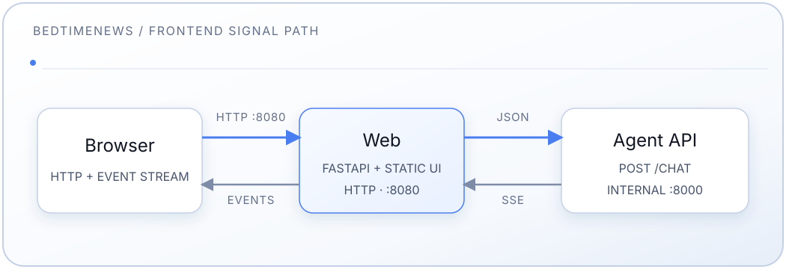

# Frontend Service

[中文](README.md) | [English](README.en.md) | [Español](README.es-ES.md)

Custom web frontend for the BedtimeNews knowledge base: a static single-page
app (HTML/CSS/JS) serving both the chat agent and the in-app transcript
archive. A small FastAPI app hosts it and proxies the chat stream and
transcript APIs to the internal agent backend; the transcript list/reader live
same-origin under `/transcripts`.

See the [main README](../README.en.md) for full-stack setup.

## Design

- **Theme:** a flat chatbot palette (ChatGPT/Claude-like defaults) — dark
  `#212121` / light `#ffffff`, one green `--accent`, no page gradients and no
  dual decorative accents. Light/dark follow `prefers-color-scheme` by default;
  the masthead SVG sun/moon toggle writes a `sessionStorage` override (survives
  reload, resets on a new tab).
- **Color tokens** are semantic (`--bg`, `--surface`, `--line`, `--text`,
  `--text-dim`, `--muted`, `--accent`, `--user-bubble`, …), defined for dark in
  `:root` and overridden under `[data-theme="light"]`.
- **Type:** system CJK sans; monospace only for a few machine labels. No webfont
  CDN.
- **Layout (automatic by viewport; no manual desktop/mobile switch):**
  - **Desktop (>900px):** a permanent 50/50 split. The left half has the
    「AI对话 | 搜索」tabs; the right half is the reading pane, showing「最新文稿」
    (the latest 50, server-rendered) by default, or a channel list or a
    transcript. Masthead shows channel links, a「最新文稿」link (clock icon)
    after a vertical divider, and framed GitHub + theme controls. Starters:
    one question per category in a 2×4 grid, plus「浏览全部文稿」channel links.
  - **Mobile (≤900px):** full-screen 检索 (AI chat or search) **or**
    archive/reader; bottom tabs「检索 | 文稿」split the bar in half, and
    「检索」returns to whichever of AI chat or search was last in use. A
    transcript opened from an AI answer or the search results floats over
    them: closing it returns to the same conversation or results, at the same
    scroll position. Starters are eight
    questions in a 2×4 grid (no category labels, no browse links). Masthead icons are borderless; the
    GitHub Edit control is desktop-only.
- **Reading chrome:** fixed-height slots (back / edit / close) so list↔article
  borders do not jump; in-article heading/footnote rule lines are suppressed.
- **Signal-acquisition log:** RAG stages (condense → … → generate) render live,
  then lock and collapse when the answer starts.

## Features

- Anonymous chat (no authentication)
- System-aware light/dark theme with SVG toggle
- Sample questions (categorised on desktop, flat on mobile) and desktop
  「浏览全部文稿」
- The「搜索」pane: keyword search over every transcript, highlighted hits,
  snippets that link to the matching section. When idle it shows the logo and
  10 random search starters; the placeholder rotates through starters every 5 s
- Search has its own address: `/search` opens the empty「搜索」page (so does
  clicking the「搜索」tab), each search updates the address to
  `/search?q=<keyword>`, and opening that address runs the search at once. On
  desktop, while a transcript is open in the right pane, the address stays on
  that transcript. Browsers can add the site as a search engine via
  `/opensearch.xml`
- 「最新文稿」has its own address, `/latest` (same as the home page on desktop;
  full-screen list on mobile)
- Channel chips, newest-first archive lists (undated last), article reader
- Desktop GitHub Edit link into
  `BedtimeNews-Transcripts/edit/main/contents/…`
- Real-time SSE streaming with visible pipeline steps
- Markdown answers via vendored markdown-it (`html:false`) and in-app citation
  navigation
- Opening `/transcripts/<URI>#<anchor>` directly, or following an in-app link
  that only changes the hash of the open transcript, scrolls the reading pane
  to that heading. A missing id stays at the top. Scrolling uses the reading
  pane, not the browser's native hash scroll
- Ephemeral, in-page conversation (cleared on refresh)
- Keyboard-accessible; respects `prefers-reduced-motion`

## Architecture



The frontend:

- Runs in a Docker container that serves plain HTTP on port 8080 (no TLS —
  public exposure and TLS termination are handled outside this repo)
- In the default deployment, is the only service published to the host (`FRONTEND_PORT`, default 8080)
- Proxies `/chat` and transcript APIs to the agent over the internal Docker
  network; the sample overlay separately binds the Agent to loopback for API development

## Components

- **server.py** — FastAPI: `static/`, server-rendered home, channel and
  transcript pages, `/api/starters`, transcript and keyword-search API proxies,
  `/chat` SSE proxy, the `/search` and `/latest` pages,
  robots/sitemap/OpenSearch/short links, health endpoints
- **starters.py** — sample-question data (categories + questions) and search
  starters
- **static/index.html** — markup, theme boot, mobile tab bar, turn templates
- **static/styles.css** — solid tokens and desktop/mobile layout
- **static/app.js** — routing, archive/reader, starters, composer, theme, SSE,
  Markdown
- **static/markdown-it.min.js** — vendored Markdown renderer (MIT), on demand
- **static/bedtimenews.webp** — favicon / brand logo
- **static/BingSiteAuth.xml** — Bing Webmaster Tools site verification
- **pyproject.toml** — `fastapi`, `uvicorn`, `httpx`

## Endpoints

| Method | Path                             | Purpose                                                                                    |
| ------ | -------------------------------- | ------------------------------------------------------------------------------------------ |
| GET    | `/`                              | Home page: the SPA shell (`static/index.html`) rendered with canonical/SEO metadata        |
| GET    | `/latest`                        | Latest transcripts (the home page's reading pane, with `ItemList` structured data)         |
| GET    | `/search?q={keyword}`            | Opens the「搜索」tab; with `q`, prefilled and run at once (results `noindex`, no canonical)  |
| GET    | `/transcripts?channel={channel}` | Server-rendered channel list (`/transcripts` without a channel: `308` to `/`)              |
| GET    | `/transcripts/{doc_id}`          | Server-rendered transcript page                                                            |
| GET    | `/api/starters`                  | Sample questions and search starters JSON (`categories`, `search`)                         |
| GET    | `/api/search`                    | Keyword search (proxied to the agent with `sort`, `channel`, `year`; status codes pass through) |
| POST   | `/api/search/click`              | Log one search-result click anonymously (to the log; returns 204)                          |
| GET    | `/api/transcripts`               | Transcript index (proxied)                                                                 |
| GET    | `/api/transcripts/{doc_id}`      | One transcript (proxied; a malformed `doc_id` is a `404` without calling the agent)        |
| POST   | `/chat`                          | Proxies the agent SSE stream (body over 128 KiB: `413`)                                    |
| GET    | `/healthz`                       | Liveness of `web` alone (never calls the agent): `status`, `version`, `instance`           |
| GET    | `/readyz`                        | Readiness of this instance: status code of the agent's `/health` (200 / 503), trimmed body |
| GET    | `/index.html`                    | `308` redirect to `/`                                                                      |
| GET    | `/robots.txt`                    | Allows all; points at the sitemap                                                          |
| GET    | `/sitemap.xml`                   | Home, `/latest`, channel lists, every transcript                                           |
| GET    | `/opensearch.xml`                | OpenSearch description; browser site search points at `/search?q=`                         |
| GET    | `/s/{short_id}`                  | Short link, `302` to the transcript                                                        |

This service proxies `/api/search` to the agent's `GET /search`; the keyword
search pane is built on it. See the
[Agent search API](../agent/README.en.md#get-search). The pane offers order
(relevance or date), channel and year filters (options from `facets`, kept in
the address `/search?q=…&sort=…&channel=…&year=…`), a "did you mean" link, and
per result "缺少：…" (missing words) or "语义相关" (found by meaning). Opening a
result sends an anonymous beacon to `/api/search/click` (query, transcript,
rank, match, mode and snapshot; no identity or address), which the server
validates and logs as `search_click {json}`; `scripts/search_clicks.py`
summarizes it. Direct localhost access on
port 18001 is provided only by the sample overlay, not by a frontend route.
Every `/api/` response carries `X-Robots-Tag: noindex` so data endpoints stay
out of search indexes; they are not blocked in robots.txt, so crawlers can
still render the pages that fetch them.

## Development Workflow

The container runs `uvicorn server:app`. After changing Python or static files,
rebuild and restart:

```bash
# The frontend is published on the host (FRONTEND_PORT, default 8080)
docker compose build web
docker compose up -d web
open http://localhost:8080
```

> Use `--no-cache` if a rebuild appears to serve stale code.

### Run without Docker

```bash
cd frontend
pip install .
# Point at a reachable agent backend:
AGENT_BACKEND_HOST=localhost AGENT_BACKEND_PORT=8000 \
  uvicorn server:app --reload --port 8080
```

### Customization

- **Starter questions / categories:** edit `starters.py` (`CATEGORIES`).
- **Styling:** edit `static/styles.css` (design tokens live in `:root`).
- **Copy / layout:** edit `static/index.html`.
- **Logo / favicon:** replace `static/bedtimenews.webp`. It renders at about
  1.85rem, so keep it small — 128px square is enough for hi-DPI, and the file is
  cached for a week by `CachedStaticFiles`.

## Configuration

| Variable                     | Default                | Purpose                                                                                                                                               |
| ---------------------------- | ---------------------- | ----------------------------------------------------------------------------------------------------------------------------------------------------- |
| `AGENT_BACKEND_HOST`         | `agent`                | Agent service name on the Docker network                                                                                                              |
| `AGENT_BACKEND_PORT`         | `8000`                 | Agent port                                                                                                                                            |
| `APP_PORT` / `FRONTEND_PORT` | `8080`                 | Host port the frontend is published on: `APP_PORT` per instance (blue-green), falling back to `FRONTEND_PORT` in `.env`                               |
| `APP_VERSION`                | (empty)                | Masthead and `/healthz` version; compose sets it from `APP_IMAGE_TAG`, falling back to `IMAGE_TAG` (`latest`/empty falls back to the package version) |
| `APP_INSTANCE`               | `local`                | Instance label reported by `/healthz` (the compose project name in blue-green deployments)                                                            |
| `PUBLIC_BASE_URL`            | `https://bedtime.blog` | Origin for canonical, sitemap and robots URLs, and for the site links in a copied answer (read by the page from a `public-base-url` meta tag) |

### Health endpoints

Both are public through the edge proxy, like every other path:

- `GET /healthz` answers from `web` alone and never calls the agent:
  `{"status":"ok","version":"0.4.0","instance":"bedtimenews-app-green"}`. A
  dead agent or database must not make an orchestrator restart `web`.
- `GET /readyz` calls this instance's agent `/health` (3 s timeout) and returns
  its status code: 200 when the agent reaches the database and serves a
  snapshot, otherwise 503. The body is trimmed to `ready`, `reason` (when not
  ready) and the snapshot's `id`, `format_version` and `embedding_space`; the
  agent's full body, which includes the indexer's last error text, is never
  forwarded. Deployment tools gate traffic on it.

The compose file health-checks `web` on `/healthz` (with Python's `urllib`:
the image has no `curl`).

### Hardening

- Only the paths above and the files in `static/` are served: FastAPI's `/docs`, `/redoc` and
  `/openapi.json` are disabled, and the transcript proxy only forwards a
  validated transcript URI, so no other agent endpoint is reachable from
  outside.
- `/chat` reads at most 128 KiB of request body (`413` beyond that); the agent
  validates the question and history limits.
- Upstream failures reach the browser as a generic message; details are only
  logged.
- Every response carries a Content-Security-Policy (`frame-ancestors 'none'`,
  `object-src 'none'`, `base-uri 'none'`, ...), `X-Content-Type-Options`,
  `X-Frame-Options` and `Referrer-Policy`.

### Graceful shutdown

On SIGTERM uvicorn stops accepting connections and lets in-flight requests,
including a streaming `/chat` (at most the agent's 240 s limit), finish for up
to 270 s; compose's `stop_grace_period` is 300 s. A `docker compose stop` or an
in-place recreate therefore waits up to 5 minutes while a stream is open.

## Debugging

```bash
# Logs
docker compose logs -f web

# Container names follow the compose project (e.g. bedtimenews-app-green-web-1),
# so address the service rather than a fixed name:
docker compose ps web
curl -s localhost:8080/readyz

# Backend connectivity from inside the container (the slim image has no
# ping/curl; use the bundled Python + httpx instead)
docker compose exec web python -c "import httpx; print(httpx.post(
    'http://agent:8000/chat', json={'question': '测试'}, timeout=120).text)"
```

## API Contract

The frontend proxies the agent's `/chat` endpoint.

### Request

```json
{
  "question": "string (required)",
  "history": [{"question": "…", "answer": "…", "grounded": true}],
  "stream": true
}
```

`history` is optional; the browser sends at most its three most recent turns.

### Streaming response (SSE)

```json
{"type": "step", "step": "condense|route|rewrite|retrieve|grade|generate", "content": "…"}
{"type": "citations", "urls": {"ShuiQianXiaoXi/0501-0600/0588.md#城投债": {"title": "睡前消息588", "url": "/transcripts/ShuiQianXiaoXi/0501-0600/0588.md#%E5%9F%8E%E6%8A%95%E5%80%BA"}, "ShuiQianXiaoXi/0501-0600/0588.md": {"title": "睡前消息588", "url": "/transcripts/ShuiQianXiaoXi/0501-0600/0588.md"}, "CanKaoXinXi/0401-0500/0490.md": {"title": "参考信息490", "url": "/transcripts/CanKaoXinXi/0401-0500/0490.md"}}}
{"type": "answer_chunk", "content": "…"}
{"type": "answer_final", "content": "…", "grounded": true}
{"type": "answer_meta", "grounded": true}
{"type": "followups", "items": ["…"]}
{"type": "error", "content": "…"}
```

The server may emit `: ping` SSE comments between events and terminates every
stream with `data: [DONE]`. A successful turn sends exactly one of
`answer_final` or `answer_meta`. Citation URLs are in-app `/transcripts/…`
paths (not GitHub Pages).

## Limitations (MVP)

- **No authentication** — anonymous only
- **No persistence** — conversation is cleared on refresh
- **Per-tab session** — no cross-tab or server-side history

## Troubleshooting

**Port 8080 in use:** set `FRONTEND_PORT` in `.env` to another host port and
recreate the service (`docker compose up -d web`).

**Cannot connect to backend:**

- `docker compose ps agent` and `docker compose logs agent`
- Connectivity check from inside the container (see [Debugging](#debugging))

**Changes not appearing:** rebuild (`--no-cache`) and hard-refresh the browser
(Cmd/Ctrl+Shift+R).
